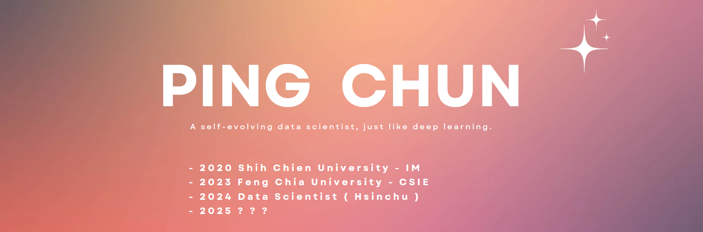

<!-- 
SOMETHING SOURCE
https://github.com/abhisheknaiidu/awesome-github-profile-readme
https://simpleicons.org/
https://emojipedia.org/bar-chart
https://icons8.com/icons
https://github.com/aleen42/badges
https://www.base64-image.de/
shields.io: https://shields.io/docs/logos
ASCII Art Generator: https://patorjk.com/software/taag/#p=display&f=BlurVision%20ASCII&t=PING%20CHUN
Font Name: Graffiti Larry 3D, Merlin1, Ogre, Calvin S, Cyberlarge, Isometric3, Slant, Lean, Kban,  JS Cursive
https://techstack-generator.vercel.app/
https://skillicons.dev/
https://github.com/tandpfun/skill-icons#readme
https://github.com/Anmol-Baranwal/Cool-GIFs-For-GitHub/tree/main?tab=readme-ov-file
https://techicons.dev/icons
-->


<!-- shield.io
<div align="center">
[](https://visitor-badge.laobi.icu/badge?page_id=Junwu0615.Junwu0615)
[](https://pc-dashboard.streamlit.app/)
[](mailto:jun.audis5@gmail.com)
</div>
-->

<!--
<div align="center">
    <table>
        <tr>
          <td align="center">
            
          </td>
          <td align="center">
            <a href="https://pc-dashboard.streamlit.app/" target="_blank">
              
            </a>
          </td>
        </tr>
    </table>
</div>

<div align="center">
    <table>
        <tr>
          <td align="center">
            <a href="mailto:jun.audis5@gmail.com" target="_blank">
              
            </a>
          </td>
          <td align="center">
            <a href="https://www.cake.me/me/Ping-Chun-Wu" target="_blank">
              
            </a>
          </td>
          <td align="center">
            <a href="https://www.linkedin.com/in/pc-wu-16a1602a7/" target="_blank">
              
            </a>
          </td>
        </tr>
    </table>
</div>
-->

<div align="center">
    <table>
        <tr>
            <td align="center">
                
            </td>
            <td align="center">
                
            </td>
        </tr>
    </table>
</div>

<div align="center">
    <table>
        <tr>
          <td align="center">
            
          </td>
          <td align="center">
            <a href="https://junwu0615.github.io/Junwu0615/" target="_blank">
              
            </a>
          </td>
          <td align="center">
            <a href="https://github.com/Junwu0615/Junwu0615-Analytics" target="_blank">
              
              <!--  -->
            </a>
          </td>
          <td align="center">
            <a href="https://www.linkedin.com/in/pc-wu-16a1602a7/" target="_blank">
              
            </a>
          </td>
          <td align="center">
            <a href="https://www.cake.me/me/Ping-Chun-Wu" target="_blank">
              
            </a>
          </td>
        </tr>
    </table>
</div>


<!-- 

-->

<br>

<!-- Introduction
<p align="center">
    <a href="https://github.com/Junwu0615">
        
    </a>
</p>
<br>
-->

<!-- Greedy Snake: https://github.com/marketplace/actions/generate-snake-game-from-github-contribution-grid -->
<p align="center">
    <picture>
        <source media="(prefers-color-scheme: dark)" srcset="https://raw.githubusercontent.com/Junwu0615/Junwu0615/output/github-contribution-grid-snake-dark.svg">
        <source media="(prefers-color-scheme: light)" srcset="https://raw.githubusercontent.com/Junwu0615/Junwu0615/output/github-contribution-grid-snake.svg">
        
    </picture>
</p>


<br><br>

<table width='1000' align="center">
<tr> <th> Platform Genesis Universe </th> </tr>
<td>

<p align="center">
  
</p>

<!-- Platform Genesis Universe -->
| <div style='width: 230px'> _**PG Project**_ </div> | <div style='width: 300px'> _**Tech Stack**_ </div> |
|--|:--|
| [_**Platform Genesis**_](https://github.com/Junwu0615/Platform-Genesis) | `PG-Core` `PG-Synapse` `PG-Cortex` `PG-Sentinel` `PG-Analytics` |
|  |  |
| [_**PG - Core**_](https://github.com/Junwu0615/PG-Core) | `Kubernetes` `GitOps` `Observability` `Infrastructure as Code`<br>`Secrets Management` |
| [_**PG - Synapse**_](https://github.com/Junwu0615/PG-Synapse) | `Airflow` `Kafka` `CDC` `Iceberg` `Lakehouse` |
| [_**PG - Cortex**_](https://github.com/Junwu0615/PG-Cortex) | `MLflow` `Kubeflow` `Ray` `LLMOps` `Model Serving` |
| [_**PG - Sentinel**_](https://github.com/Junwu0615/PG-Sentinel) | `AIOps` `Chaos Engineering` `Reliability` `Auto Remediation` |
|  |  |
| [_**PG - Infrastructure**_](https://github.com/Junwu0615/PG-Infrastructure) | `GKE` `Kubernetes` `Terraform` `Ansible` `Docker` `Makefile` |
| [_**PG - APP-Core**_](https://github.com/Junwu0615/PG-APP-Core) | `PG-Shared-Lib` `Python` |
| [_**PG - Shared-Lib**_](https://github.com/Junwu0615/PG-Shared-Lib) | `EntryPoint` `Logger` `MqttServer`<br>`KafkaConsumerManager` `KafkaProducerManager` |
| [_**PG - Edge-Container**_](https://github.com/Junwu0615/PG-Edge-Container) | `PG-APP-Core` `MQTT` `SQLite` |
| [_**PG - Airflow-DAGs**_](https://github.com/Junwu0615/PG-Airflow-DAGs) | `Airflow` `DAGs` |
|  |  |
| [_**PG - Analytics**_](https://github.com/Junwu0615/PG-Analytics) | `GitHub Traffic` `Repository Metrics` `Growth Trend`<br>`Historical Statistics` |

</td> </table>

<br>

<!-- Other -->
<details>
    <summary> 📈 Other </summary>
    <br>
    <table align="center"> 
        <tr>
            <th> LeetCode Stat </th>
        </tr>
        <tr>
            <td>
                
            </td>
        </tr>
        <tr>
            <th> Me </th>
        </tr>
        <tr>
            <td>
                <p align="center">
                  
                </p>
        </tr>
    </table> 
</details>


<br>

<!-- WakaTime Stat: https://wakatime.com/settings | teaching: https://blog.csdn.net/weixin_43233914/article/details/126087735 -->
<details>
<summary> ⏲️ WakaTime Stat </summary>
<br>

<!--START_SECTION:waka-->


**🐱 My GitHub Data** 

> 📦 290.8 kB Used in GitHub's Storage 
 > 
> 🏆 2,180 Contributions in the Year 2026
 > 
> 🚫 Not Opted to Hire
 > 
> 📜 49 Public Repositories 
 > 
> 🔑 17 Private Repositories 
 > 
**I'm a Night 🦉** 

```text
🌞 Morning                372 commits         ██░░░░░░░░░░░░░░░░░░░░░░░   09.33 % 
🌆 Daytime                993 commits         ██████░░░░░░░░░░░░░░░░░░░   24.90 % 
🌃 Evening                1587 commits        ██████████░░░░░░░░░░░░░░░   39.79 % 
🌙 Night                  1036 commits        ██████░░░░░░░░░░░░░░░░░░░   25.98 % 
```
📅 **I'm Most Productive on Sunday** 

```text
Monday                   609 commits         ████░░░░░░░░░░░░░░░░░░░░░   15.27 % 
Tuesday                  511 commits         ███░░░░░░░░░░░░░░░░░░░░░░   12.81 % 
Wednesday                524 commits         ███░░░░░░░░░░░░░░░░░░░░░░   13.14 % 
Thursday                 476 commits         ███░░░░░░░░░░░░░░░░░░░░░░   11.94 % 
Friday                   571 commits         ████░░░░░░░░░░░░░░░░░░░░░   14.32 % 
Saturday                 636 commits         ████░░░░░░░░░░░░░░░░░░░░░   15.95 % 
Sunday                   661 commits         ████░░░░░░░░░░░░░░░░░░░░░   16.57 % 
```


📊 **This Week I Spent My Time On** 

```text
🕑︎ Time Zone: Asia/Taipei

💬 Programming Languages: 
Markdown                 6 hrs 33 mins       ██████████████░░░░░░░░░░░   56.46 % 
Text                     1 hr 39 mins        ████░░░░░░░░░░░░░░░░░░░░░   14.32 % 
YAML                     1 hr                ██░░░░░░░░░░░░░░░░░░░░░░░   08.67 % 
Python                   56 mins             ██░░░░░░░░░░░░░░░░░░░░░░░   08.15 % 
Makefile                 32 mins             █░░░░░░░░░░░░░░░░░░░░░░░░   04.62 % 

🔥 Editors: 
PyCharm                  11 hrs 29 mins      █████████████████████████   98.99 % 
Unknown Editor           7 mins              ░░░░░░░░░░░░░░░░░░░░░░░░░   01.01 % 

💻 Operating System: 
Windows                  11 hrs 36 mins      █████████████████████████   100.00 % 
```

**I Mostly Code in Python** 

```text
Python                   47 repos            █████████████████████░░░░   82.46 % 
PowerShell               3 repos             █░░░░░░░░░░░░░░░░░░░░░░░░   05.26 % 
Makefile                 3 repos             █░░░░░░░░░░░░░░░░░░░░░░░░   05.26 % 
HTML                     2 repos             █░░░░░░░░░░░░░░░░░░░░░░░░   03.51 % 
Jupyter Notebook         1 repo              ░░░░░░░░░░░░░░░░░░░░░░░░░   01.75 % 
```


 Last Updated on 23/07/2026 03:19:26 UTC
<!--END_SECTION:waka-->
</details>

<br>

<!-- My GitHub Stat -->
<details>
    <summary> 📊 GitHub Stat </summary>
    <br>
    <table align="center"> 
        <tr>
            <th> Repos Per Language </th>
            <th> Activity </th>
        </tr>
        <tr>
            <td>
                
            </td>  
            <td>
                
            </td>
        </tr>
    </table> 
</details>